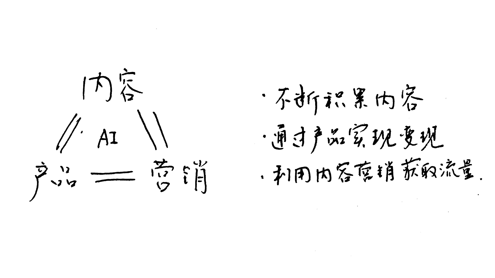

这是我花了三年时间打磨出来的**内容创业三角形**：三个顶点分别是内容（CONTENT）、产品（PRODUCT）和营销（MARKETING），中心是 AI。

具体到执行层面：
- 持续积累，做厚「内容」
- 通过「产品」实现变现
- 借助「内容营销」获取流量
- 依靠 AI 打造极致的运营效率

这个模型和我的个人特性十分契合。要用它实现商业目标，关键是让内容、产品和营销持续推进。

现阶段，最重要的不是构想更多可能性，而是**提高执行力**。最务实最有效的办法，就是把每一件小事分步骤落实：

- 重新整理现有内容，统一托管至 Github。
- 梳理出可以变现的产品，并提前确定交付渠道和营销策略。
- 集中精力深耕某一个营销渠道，避免精力分散。
- 利用 AI 搭建自动化工作流，把以上三个步骤串联起来。

回顾过去，我做了很多事，为什么至今仍未实现商业目标？

我认为症结在于**火力过于分散**和**缺乏连续作战能力**。前者让我无法把一件事情做深做透，后者让我无法在一件事上持续投入。这两个执行力上的缺陷相互叠加，使我错失了不少打造爆款产品或内容的机会。

好在，我找到了解法：**以项目的形式管理工作，集中火力，连续作战**。

既然内容已经全部托管在 Github 上，我就直接使用它内置的 Projects 来管理项目。内容、代码、项目无缝衔接，当年做程序员时养成的工程思维，终于又派上了用场。

---

**相关推文：**

- [从写日本史到教日语，我怎么找到能长期做的内容](/2025/09/29/my-content-business-journey.html)
- [从写代码到独立教日语，我想做什么](/2025/10/01/becoming-an-independent-japanese-teacher.html)
- [从第一篇日语文章到卖 PDF，我走通了哪几步](/2025/10/28/building-a-sustainable-content-business.html)
