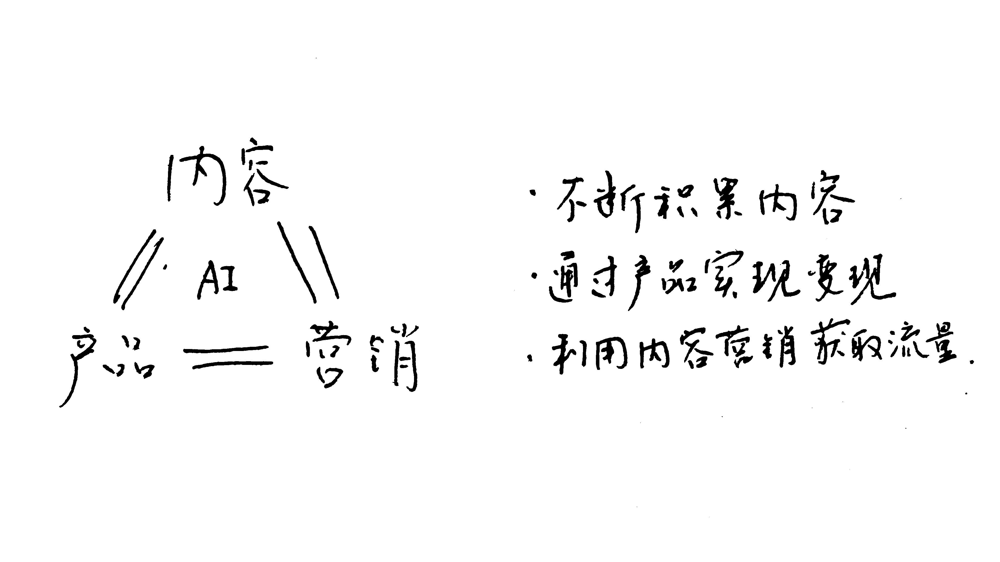

我在[《内容创业三角形：用 AI 串起内容、产品和营销》]()中总结过自己的创业模型：

三角形的三个顶点分别是「内容」「产品」和「营销」。它们你中有我、我中有你，相互支撑，也能相互转化。AI 位于三角形的中心，主要起到加速推进的作用。而我要做的，就是围绕这三个顶点发挥想象力，借助 AI 把想法落地。

模型虽然简单，却有一个重要的启动条件：**先建立一套比较完整的知识体系**。

## 内容

过去三年，我投入心血最多的领域就是「内容」。为了构建一个比较完整的日语知识体系，我花了很长时间阅读相关书籍，又通过写两套语法教程，检验自己是不是真弄懂了。

写教程是践行费曼学习法，持续发布内容也让我在小红书、公众号和视频号三个平台一共积累了 1.5 万粉丝。

为了把日语知识按结构存下来，我还开发了一套内容管理系统。这个系统不但能批量生产社媒内容，还能快速制作知识产品。

AI 加快了内容的积累和创作，但我最近已经想不出多少让自己兴奋的内容点子了。所以下一步，除了继续保持大量阅读、维持社媒账号的活跃，**我要把工作重心从「内容」转移到「产品」**。

## 产品

其实，我已经试过在三个渠道卖产品：在公众号和知乎做付费专栏，在小红书卖 PDF。效果不算理想，但至少说明我做的内容有人愿意付费。只是受众还不够广，目前还撑不起稳定的现金流。

所以，做出更多适合不同读者的产品、丰富变现方式，是当前最要紧的工作。我已经想了几个方案，正在推进，具体可见[《日语内容如何变现：为什么先做五十音和 JLPT 语法 App》]()。

我还想开发一些实物产品、开展线上培训。这些都是后话，现阶段还是先把线上产品做出来。

这些产品都是从「内容」这个主干上长出来的。等产品做起来，开发过程和使用方法又可以继续写成内容。希望这一天早日到来。

## 营销

这三年，我一边积累内容，一边往外发布，也摸索出了一些社媒运营的办法。不过到现在还没有做出过爆款，有些遗憾。等产品做实做透之后，我会再花时间研究怎么推广。

持续发布也反过来推动我积累内容。只是我一个人的精力有限，产品开发这段时间，社媒就先保持一定的活跃度。

对我来说，营销的核心作用是推广产品、实现变现。具体的安排已经写在[《日语教学与日本历史文化：五个平台怎么分工》]()和[《日语内容如何涨粉：多平台日更，下一步试水直播》]()里。
